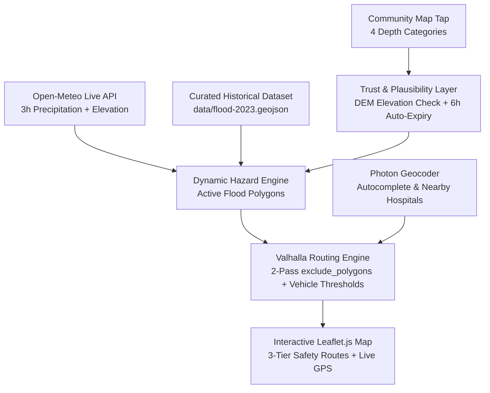

<div align="center">

# 🌊 Safe Roads in Floods (`Flood_safe_road`)
### Community-Powered, Real-Time Hydrological & Vehicle-Aware Safe Routing

<div align="center">

# 🌊 Safe Roads in Floods (`Flood-Safe-Road`)
### Community-Powered, Real-Time Hydrological & Vehicle-Aware Safe Routing

[](https://github.io)
[](https://github.com)
[](LICENSE)
[](#)

*Helping residents, two-wheeler riders, delivery workers, and emergency responders navigate flooded cities safely—without paid APIs or proprietary infrastructure.*


*Helping residents, two-wheeler riders, delivery workers, and emergency responders navigate flooded cities safely—without paid APIs or proprietary infrastructure.*

</div>

---

## 🎯 The Problem & Motivation

During urban floods—such as **Chennai’s Cyclone Michaung in December 2023**—residents must decide within minutes whether a street is safe to walk, ride, or drive through. 

* **Standard navigation apps** optimize for travel time, not water depth—often routing two-wheelers and compact cars directly into submerged subways and marooned neighbourhoods.
* **Satellite radar (Sentinel-1 SAR)** penetrates cloud cover to map broad flood footprints, but passes are infrequent and lose accuracy between dense urban buildings.
* **The Solution:** **Safe Roads in Floods** bridges the gap between slow satellite observations and fast ground reality by fusing **real-time precipitation data**, **Digital Elevation Model (DEM) plausibility checks**, **community depth reports**, and **vehicle-specific polygon-avoidance routing**.

---

## ✨ Core Features

### 1. 🚗 Vehicle-Aware Wading Depth Routing
Roads are dynamically evaluated against the selected vehicle's safe ground-clearance threshold before computing detours:

| Mode | Max Safe Depth | Routing Behaviour |
| :--- | :---: | :--- |
| **🚶 Walk** | `≤ 12 cm` | Avoids ankle-deep stagnation and submerged pedestrian paths |
| **🛵 Bike / 2-Wheeler** | `≤ 18 cm` | Protects riders from exhaust flooding and hidden potholes |
| **🚗 Car** | `≤ 32 cm` | Routes around knee-deep waterlogging while allowing shallow runoff |
| **🚙 Rescue SUV** | `≤ 65 cm` | High-clearance emergency routing for relief and rescue operations |

### 2. 🚦 3-Tier Visual Route Safety Classification
* 🟢 **Green Solid Line (`Complete Safe Route`):** 100% flood-free path verified against all active hazard zones.
* 🟠 **Orange Solid Line (`Partial Risk Detour`):** Best available path when an origin or destination lies inside an unavoidable flood zone, with explicit hazard warnings.
* 🔴 **Red Dashed Line (`Flooded Direct Route`):** Baseline shortest path displayed for distance and risk comparison.

### 3. 🌦️ Dual-Mode Intelligence: Live Weather + Dec 2023 Case Study
* **🟢 Live Weather Mode:** Fetches real-time 3-hour precipitation across 20 historical Chennai flood hotspots via the **Open-Meteo API** and computes live water depth using local drainage vulnerability weights.
* **🟠 Dec 2023 Cyclone Simulation:** Replays verified December 2023 inundation data (`data/flood-2023.geojson`) across Velachery, Pallikaranai, Mudichur, Saidapet, T. Nagar, and 15 other neighbourhoods.

### 4. 📢 Community Reporting & Trust Layer
* **4-Level Depth Picker:** Right-click anywhere on the map to report flooding using intuitive visual benchmarks (**Ankle**, **Knee**, **Half Wheel**, **Above Wheel**).
* **DEM Elevation Cross-Check:** Automatically queries **Open-Meteo's Elevation API** (meters above sea level) to flag low-lying terrain plausibility.
* **Auto-Expiry:** Community reports automatically expire after 6 hours so receding floodwater never permanently blocks a road.

### 5. 🚨 Emergency Hospital Finder & Live GPS Navigation
* **Nearest Safe Hospital:** Scans real OpenStreetMap medical facilities within 3 km via **Photon**, filters out hospitals inside flooded zones, and routes to the closest dry facility.
* **Live GPS & Simulated Drive:** Tracks real-time device movement (`navigator.geolocation.watchPosition`) or animates a turn-by-turn drive preview along the safe detour.

---

## 🏗️ System Architecture



---

## 🛠️ 100% Open-Source & Zero-Cost Tech Stack

| Layer | Technology / Open Data | Purpose |
| :--- | :--- | :--- |
| **Frontend & UI** | HTML5, CSS3, Vanilla JavaScript, [Leaflet.js](https://leafletjs.com) | Lightweight, zero-build client-side map interface |
| **Routing Engine** | [Valhalla](https://github.com) (`valhalla1.openstreetmap.de`) | Dynamic runtime `exclude_polygons` detour calculation |
| **Weather & DEM** | [Open-Meteo Weather & Elevation APIs](https://open-meteo.com) | Real-time hourly precipitation & ground elevation (ASL) |
| **Geocoding & POIs** | [Photon API](https://komoot.io) (OpenStreetMap) | Fast location autocomplete & nearby hospital discovery |
| **Base Map & Data** | [OpenStreetMap](https://openstreetmap.org) & `data/flood-2023.geojson` | Street network tiles & verified Dec 2023 flood dataset |

---

## 🚀 Run Locally in 10 Seconds

No Node.js installation, backend server, or API keys are required:

```bash
# 1. Clone the repository
git clone https://github.com.git

# 2. Navigate into the project directory
cd Flood_safe_road

# 3. Open index.html in your browser (or launch with VS Code Live Server)
```

---

## ⚠️ Honest Limitations & Safety Disclaimer

* **Guidance, Not a Guarantee:** This student-built prototype provides decision-support guidance based on open weather models, elevation data, and community inputs—it is not an official government disaster warning system.
* **Threshold Calibration:** Vehicle wading depths (`12 cm` to `65 cm`) represent baseline engineering assumptions and should be calibrated with local transport and disaster-response authorities.
* **Future Roadmap:** Persistent multi-user database sync (Supabase/PostGIS), offline tile caching for low-connectivity emergencies, and SMS/WhatsApp low-bandwidth reporting.

---

## 👩‍💻 Author

**Vishnupriya V**  
M.tech in Robotics and Artificial Intelligence (2028) - M.S. Ramaiah Institute of Technology (RIT), Bengaluru  
*Concept proposal submitted to the **Tata Young Social Innovator Challenge (TYSIC)** • Sector: Disaster Resilience*  
🔗 GitHub: [@Vishnupriya280104](https://github.com)

---

## 📄 License

Distributed under the **MIT License**. Free for any city, college, or community group to fork and adapt for local flood resilience.
