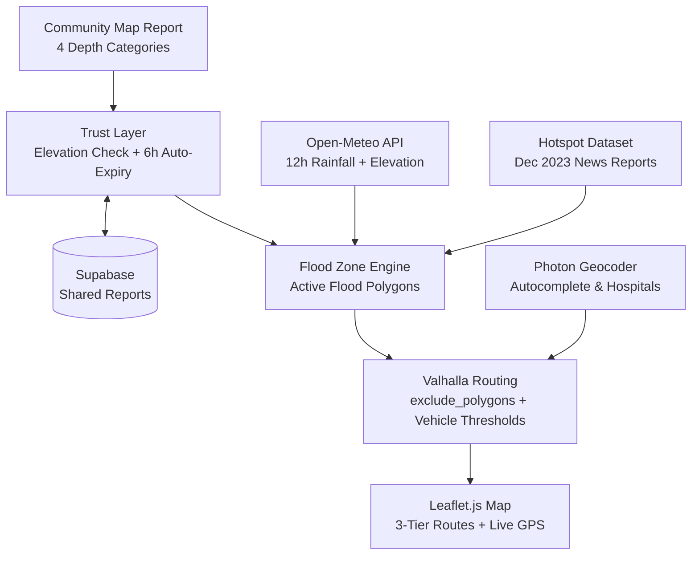

# Safe Roads in Floods (`Flood-Safe-Road`)
 
### Community-Powered, Vehicle-Aware Flood Risk Routing for Chennai
 
**[Live Demo](https://vishnupriya280104.github.io/Flood-Safe-Road/)** • 100% open-source & free APIs
 
*Helping residents, two-wheeler riders, delivery workers, and emergency responders navigate flooded cities more safely, without paid APIs or proprietary infrastructure.*
 
---
 
## The Problem & Motivation
 
During urban floods, such as **Chennai's Cyclone Michaung in December 2023**, residents must decide within minutes whether a street is safe to walk, ride, or drive through.
 
* **Standard navigation apps** optimise for travel time, not water depth, and can send two-wheelers and compact cars straight into submerged subways and marooned neighbourhoods.
* **Satellite radar (Sentinel-1 SAR)** can map broad flood footprints through cloud cover, but passes are infrequent and accuracy drops between dense urban buildings.
* **The idea:** bridge the gap between slow satellite observations and fast ground reality by combining **recent rainfall data**, **elevation plausibility checks**, **community depth reports**, and **vehicle-specific route avoidance**.
---
 
## Core Features
 
### 1. Vehicle-Aware Wading Depth Routing
Flood zones deeper than the selected vehicle's threshold are excluded before the detour is computed:
 
| Mode | Max Safe Depth | Routing Behaviour |
| :--- | :---: | :--- |
| **Walk** | `≤ 12 cm` | Avoids ankle-deep stagnation and submerged pedestrian paths |
| **Bike / 2-Wheeler** | `≤ 18 cm` | Protects riders from exhaust flooding and hidden potholes |
| **Car** | `≤ 32 cm` | Routes around knee-deep waterlogging while allowing shallow runoff |
| **Rescue SUV** | `≤ 65 cm` | High-clearance routing for relief and rescue operations |
 
### 2. 3-Tier Route Safety Classification
* **Green solid line (Complete Safe Route):** avoids all flood zones that are too deep for the selected vehicle.
* **Orange solid line (Partial Safe):** best available path when some flooded zones cannot be avoided (for example, the start or destination is inside one), with explicit warnings.
* **Red dashed line (Flooded Direct Route):** the shortest path, shown for distance and risk comparison.
### 3. Two Modes: Live Weather and Dec 2023 Case Study
* **Live Weather mode:** fetches the last 12 hours of rainfall for 20 Chennai flood hotspots from the **Open-Meteo API** and estimates water depth using a rainfall-based formula weighted by each hotspot's historical severity.
* **Dec 2023 Demo mode:** replays flood hotspots compiled from news reports of Cyclone Michaung (Velachery, Pallikaranai, Mudichur, Madipakkam, Sholinganallur and others), each with its source noted.
### 4. Community Reporting & Trust Layer
* **4-level depth picker:** right-click (or long-press on mobile) anywhere on the map to report flooding using visual benchmarks (Ankle, Knee, Half Wheel, Above Wheel).
* **Elevation cross-check:** queries Open-Meteo's Elevation API to flag whether the reported spot is low-lying terrain.
* **Confirmations & auto-expiry:** other users can confirm a report, and reports expire after 6 hours so receding water never blocks a road permanently.
* **Shared database:** reports are stored in **Supabase** so all users see them.
### 5. Emergency Hospital Finder & Live GPS Navigation
* **Nearest Safe Hospital:** searches OpenStreetMap hospitals within 3 km using the **Photon** geocoder, filters out hospitals inside flooded zones, and routes to the closest reachable one. A built-in list of major Chennai hospitals is used as a backup if the search fails.
* **Live GPS & Simulated Drive:** tracks device movement with `navigator.geolocation.watchPosition`, or animates a drive preview along the chosen route, with turn-by-turn directions.
---
 
## System Architecture
 

 
---
 
## Tech Stack (Open-Source / Free Tier)
 
| Layer | Technology / Data | Purpose |
| :--- | :--- | :--- |
| **Frontend & UI** | HTML, CSS, vanilla JavaScript, [Leaflet.js](https://leafletjs.com) | Lightweight, zero-build map interface |
| **Routing Engine** | [Valhalla](https://valhalla.github.io/valhalla/) (public server at `valhalla1.openstreetmap.de`) | Runtime `exclude_polygons` detour calculation |
| **Weather & Elevation** | [Open-Meteo APIs](https://open-meteo.com) | Hourly rainfall and ground elevation |
| **Geocoding & Places** | [Photon](https://photon.komoot.io) (OpenStreetMap data) | Location autocomplete and nearby hospitals |
| **Community Reports DB** | [Supabase](https://supabase.com) (free tier) | Shared, auto-expiring flood reports |
| **Base Map** | [OpenStreetMap](https://www.openstreetmap.org) | Street network tiles |
 
---
 
## Run Locally
 
No Node.js install or build step is needed:
 
```bash
# 1. Clone the repository
git clone https://github.com/Vishnupriya280104/Flood-Safe-Road.git
 
# 2. Go into the project folder
cd Flood-Safe-Road
 
# 3. Open index.html in your browser (or use VS Code Live Server)
```
 
---
 
## Honest Limitations & Safety Disclaimer
 
* **Guidance, not a guarantee:** this is a student-built prototype. It is **not** an official disaster warning system. Never rely on it alone in an emergency, and follow instructions from local authorities.
* **Estimated depths:** live water depths are estimated from recent rainfall and per-hotspot weights, not measured by sensors or a hydrological model.
* **Limited coverage:** the hotspot list covers 20 Chennai locations compiled from news reports. A flooded road that is not in the list will not be avoided.
* **Threshold calibration:** vehicle wading depths (12 cm to 65 cm) are baseline assumptions and should be calibrated with local transport and disaster-response experts.
* **Public routing server:** Valhalla runs on a free public demo server with no uptime guarantee, so routing may be slow or unavailable at times.
* **Community report quality:** reports are crowd-sourced. The elevation check and confirmations reduce false reports but do not eliminate them.
## Roadmap
 
* Expand the hotspot dataset from 20 to 50+ locations, with sources
* Move hotspot data into a separate `data/` file
* Offline map-tile caching for low-connectivity emergencies
* SMS / WhatsApp low-bandwidth reporting
* Self-hosted routing instance for reliability
---
 
## Author
 
**Vishnupriya V**
M.Tech in Robotics and Artificial Intelligence (2028), M.S. Ramaiah Institute of Technology (MSRIT), Bengaluru
*Concept proposal submitted to the **Tata Young Social Innovator Challenge (TYSIC)** • Sector: Disaster Resilience*
GitHub: [@Vishnupriya280104](https://github.com/Vishnupriya280104)
 
---
 
## License
 
Distributed under the **MIT License**. Free for any city, college, or community group to fork and adapt for local flood resilience.
 